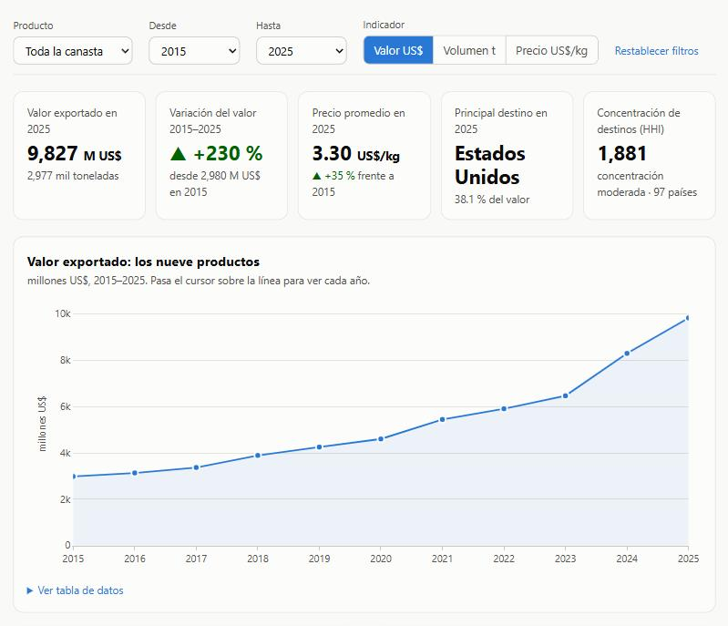
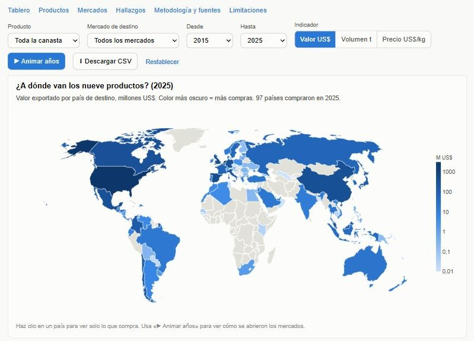
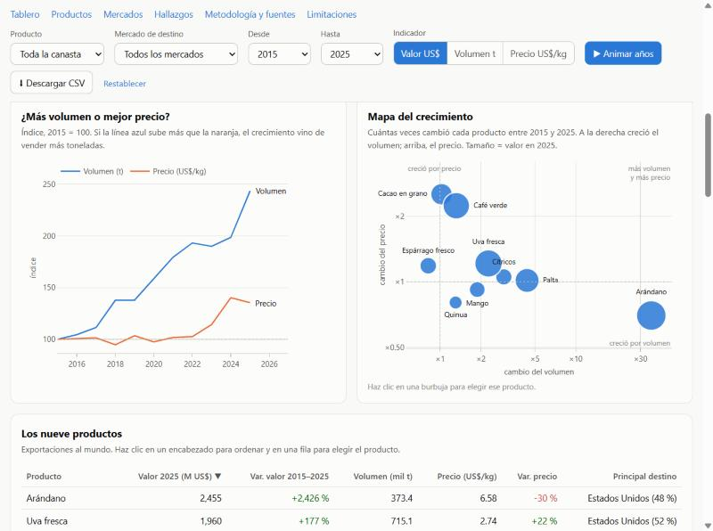
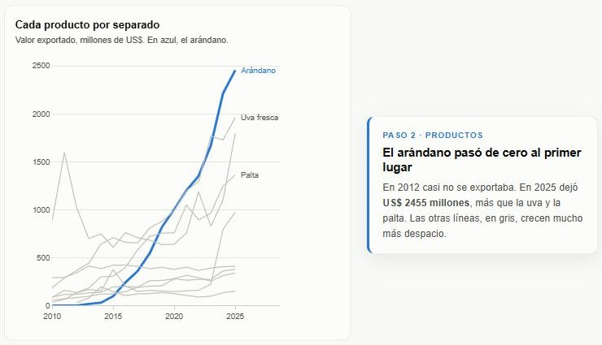

# Tarea 3 – El boom agroexportador del Perú, 2010–2025

**Autora:** Karen Macedo · Python Intermedio

**Pregunta de investigación:** ¿qué productos y qué mercados explican el crecimiento de la agroexportación peruana entre 2010 y 2025, y ese crecimiento vino de vender *más* (volumen) o de vender *más caro* (precio)?

- 📊 **Dashboard público:** https://karivanne2-a11y.github.io/Python-Tareas/tarea_3/web/
- 🎬 **Reel:** [`reel/reel.mp4`](reel/reel.mp4)
- 💼 **Publicación de LinkedIn:** _(enlace pendiente)_

## Descripción

El proyecto sigue nueve productos emblemáticos de la agroexportación peruana: palta, arándano, uva fresca, espárrago fresco, mango, café verde, cítricos, cacao en grano y quinua. Para cada uno mide el valor exportado, el volumen, el precio implícito por kilo y los países de destino. Además separa el crecimiento del valor en un efecto volumen y un efecto precio, y muestra en un mapa a dónde va cada producto.

**Cómo está organizado el dashboard:** siete capítulos (I Panorama · II Productos · III Mercados · IV La historia · V Contexto · VI Hallazgos · VII Método). Un índice fijo en la esquina marca el capítulo que estás leyendo y lleva a cualquiera de ellos. Una barra arriba muestra el avance de lectura. En el capítulo IV, *La historia en cuatro pasos*, el gráfico queda fijo y cambia a medida que bajas por la página (scrollytelling).

**Qué se puede hacer en el dashboard:**
- **Filtros:** producto, mercado de destino (147 países), rango de años e indicador (valor, volumen o precio por kilo).
- **▶ Animar años:** recorre año a año el periodo elegido y actualiza el mapa, los KPIs y los gráficos.
- **Clic para filtrar:** un país en el mapa o una barra de destinos filtra todo por ese mercado; una burbuja, una barra del ranking o una fila de la tabla elige el producto.
- **Mapa del crecimiento:** burbujas que muestran cuántas veces cambiaron el volumen y el precio de cada producto.
- **Tabla ordenable** de los nueve productos, con su principal destino.
- **Descarga en CSV** de la selección actual.
- **Validación:** un gráfico compara el total de Comtrade con la cifra oficial del BCRP.
- **Hallazgos con botón** «Ver en el tablero», que lleva al dato que los respalda.
- **Enlace compartible:** el estado de los filtros queda en la URL.

## Datos y metodología

| Fuente | Qué se usó | Acceso |
|---|---|---|
| UN Comtrade | Exportaciones anuales del Perú (reporter 604) por código HS y país de destino, 2010–2025. También el total por capítulo HS. | API pública *preview*, sin clave: https://comtradeplus.un.org/ |
| BCRP | Serie PN38714BM, exportaciones FOB mensuales (millones US$), usada para contrastar el total | https://estadisticas.bcrp.gob.pe/estadisticas/series/ |

Los datos se consultaron el 4 de noviembre de 2026. Los archivos crudos están en `datos/originales/`.

**Procesamiento** (`scripts/procesar_datos.py`):
- Se usan solo los registros agregados de Comtrade (todos los medios de transporte y regímenes) y se eliminan duplicados por año, producto y destino.
- **Precio implícito** = valor FOB / peso neto (US$/kg). En los años en que el total mundial venía sin peso (por ejemplo, 2015), se usó la suma del peso por destino.
- Los países se identifican con su código ISO3 para el mapa, y se descartan las agrupaciones regionales.
- **Peso del agro** = suma de los capítulos HS 01–24 dividida entre el total exportado.

**Análisis** (`scripts/analizar_datos.py`):
- **Descomposición volumen/precio**, 2015–2025: crecimiento del valor = crecimiento del volumen × crecimiento del precio.
- **Concentración de destinos:** índice Herfindahl-Hirschman, HHI = Σ cuota² × 10 000.
- Todas las cifras de los hallazgos quedan en `datos/procesados/hallazgos.json`.

## Tres hallazgos principales

1. **El arándano pasó de casi cero a ser el primer producto.** En 2012 se exportaron US$ 0,5 millones; en 2025, US$ 2455 millones, más que la uva (US$ 1960 M) y la palta (US$ 1363 M). Entre los tres pasaron del 17 % al 59 % de la canasta, que se multiplicó por 6: de US$ 1632 M en 2010 a US$ 9827 M en 2025.
2. **Las frutas crecieron por volumen; el cacao y el café, por precio.** Entre 2015 y 2025:
   - El arándano multiplicó su volumen por 36 mientras su precio por kilo bajó 30 %.
   - La palta creció 338 % en toneladas con un precio casi igual (+2 %).
   - El cacao subió su valor 159 % con el mismo volumen (+3 %), porque su precio aumentó 153 %.
   - En el café, el precio (+124 %) explica tres cuartas partes del alza.
3. **Dos mercados compran más de la mitad.** En 2025, Estados Unidos (38 %) y Países Bajos (17 %) compraron el 55 % de estos productos, frente al 51 % de 2015. El HHI de destinos es ≈ 1881 (concentración moderada), aunque los envíos llegan a 97 países.

Además, el peso del agro (capítulos HS 01–24) en las exportaciones totales del Perú subió del 16 % en 2010 al 21 % en 2025.






## Limitaciones

- **Comtrade frente al BCRP:** el total anual de Comtrade difiere de la cifra oficial del BCRP entre −12 % y +12 % según el año, por diferencias de registro y revisiones. Las tendencias son robustas; los niveles exactos deben leerse con cautela.
- **Datos de 2025:** son los primeros que reportó el país y pueden revisarse.
- **Quinua:** tiene código HS propio solo desde 2012, así que su serie empieza ese año.
- **Cobertura:** son nueve productos, no todo el agro. Quedan fuera, por ejemplo, el banano, la páprika y los procesados.
- **Precio implícito:** es un promedio por kilo que mezcla calidades, presentaciones y meses.
- **Alcance:** el análisis es descriptivo y no identifica causas (clima, tratados comerciales, irrigación).

## Estructura

```
tarea_3/
├── README.md
├── pyproject.toml, requirements.txt
├── datos/
│   ├── originales/      respuestas crudas de Comtrade y BCRP (JSON)
│   └── procesados/      productos_anual.csv, destinos.csv, agro_vs_total.csv, precio_volumen.csv, hallazgos.json
├── scripts/
│   ├── obtener_datos.py
│   ├── procesar_datos.py
│   └── analizar_datos.py
├── web/
│   ├── index.html       dashboard (HTML + Plotly.js)
│   ├── data/datos.json
│   └── assets/          capturas del dashboard
└── reel/
    ├── guion.json       guion de 6 escenas con las cifras verificadas
    ├── graficos.py      gráficos de cada escena
    ├── reel.py, hacer_reel.py   voz clonada + video animado (adaptado de la sesión 15)
    ├── recortar_voz.py  elige 15-25 s de la grabación como voz de referencia
    ├── subtitulos.srt, reel.mp4
    └── recursos/        gráficos y captura del dashboard usados en el reel
```

## Cómo reproducirlo

Requiere [uv](https://docs.astral.sh/uv/) (o `pip install -r requirements.txt`).

```bash
cd tarea_3
uv run python scripts/obtener_datos.py     # descarga (omite lo que ya existe)
uv run python scripts/procesar_datos.py
uv run python scripts/analizar_datos.py    # genera hallazgos.json y web/data/datos.json
uv run python -m http.server 8000 --directory web   # abrir http://localhost:8000
```

Reel. Graba entre 15 y 25 segundos de tu voz en `reel/recursos/mi_voz.m4a`; ese archivo no se sube al repositorio. Luego:

```bash
uv run python reel/graficos.py
uv run python reel/hacer_reel.py --muda                                  # vista previa sin voz
uv run --extra reel python reel/recortar_voz.py audio.ogg                       # muestra la transcripción con tiempos
uv run --extra reel python reel/recortar_voz.py audio.ogg --desde 0.6 --hasta 24.3  # recorta 15-25 s -> recursos/mi_voz.wav
uv run --extra reel python reel/hacer_reel.py --voz reel/recursos/mi_voz.wav
uv run --extra reel python reel/hacer_reel.py --reusar                          # rehace subtítulos y video sin volver a narrar
```

En Windows, si `ctranslate2` o `torch` no cargan (`WinError 126`), falta el runtime de Visual C++. Instala el [Microsoft Visual C++ Redistributable](https://aka.ms/vs/17/release/vc_redist.x64.exe).

Qué tiene el reel:
- Dura 55 segundos, en formato vertical 1080 × 1920, con 6 escenas.
- Cada escena combina una foto del producto o del transporte (de fondo, oscurecida y con un zoom lento) con un gráfico o una captura del dashboard. El gráfico aparece con un barrido animado, la cifra cuenta hacia arriba y debajo va un dato de contexto.
- Los subtítulos se resaltan palabra por palabra. Su texto sale del guion y Whisper solo aporta los tiempos, así que un error de transcripción no llega a la pantalla.
- Lleva el aviso «VOZ GENERADA CON IA» y créditos de fuente, gráficos y música.

La narración usa Qwen3-TTS (Qwen/Qwen3-TTS-12Hz-0.6B-Base), que clona la voz de la autora. Los subtítulos y el control de calidad (WER por escena) usan faster-whisper. El video se arma con Pillow y ffmpeg, en formato 1080 × 1920. La música de fondo se genera por código (acordes con ondas seno), así que no tiene derechos de autor.


**Créditos de las fotos** (Wikimedia Commons):

| Foto | Autor | Licencia |
|---|---|---|
| [Arándanos](https://commons.wikimedia.org/wiki/File:Blueberries_in_harvest_season.jpg) | Marc-Lautenbacher | CC BY-SA 4.0 |
| [Palta Hass](https://commons.wikimedia.org/wiki/File:Avocado_Hass_-_single_and_halved.jpg) | Ivar Leidus | CC BY-SA 4.0 |
| [Mazorca de cacao](https://commons.wikimedia.org/wiki/File:Cacao-pod-k4636-14.jpg) | Keith Weller, USDA ARS | Public domain |
| [Buque portacontenedores refrigerado](https://commons.wikimedia.org/wiki/File:Container_Ship_Dole_Maya.jpg) | GuavaTrain | CC0 |
| [Uva de mesa](https://commons.wikimedia.org/wiki/File:2021-08-14_15_18_00_Black_seedless_table_grapes_in_the_Franklin_Farm_section_of_Oak_Hill,_Fairfax_County,_Virginia.jpg) | Famartin | CC BY-SA 4.0 |

## Uso de IA

Se usó un asistente de IA (Claude) para buscar fuentes, escribir el código de descarga, procesamiento y dashboard, y redactar el guion. La narración del reel es una voz generada con IA (Qwen3-TTS) a partir de la voz de la autora. Las fotos no fueron generadas con IA: son fotos reales con licencia libre. Las cifras se verificaron contra los datos procesados (`hallazgos.json`) y se contrastaron con el BCRP.
