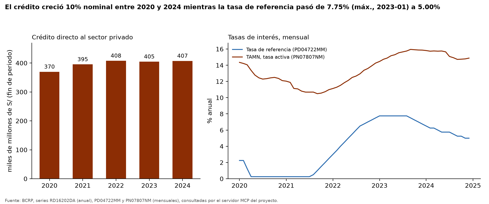
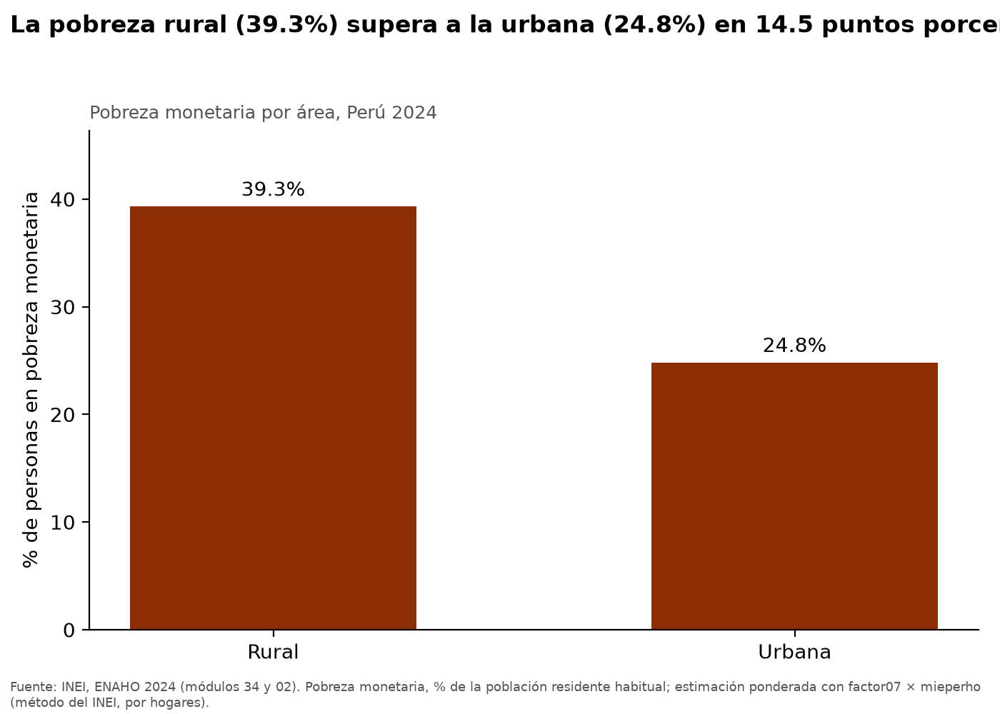
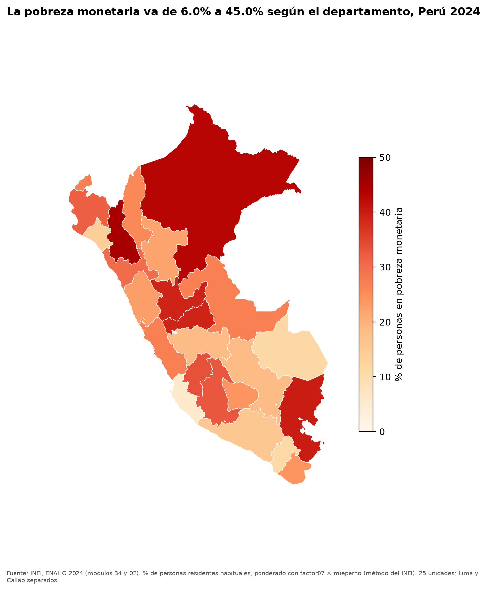
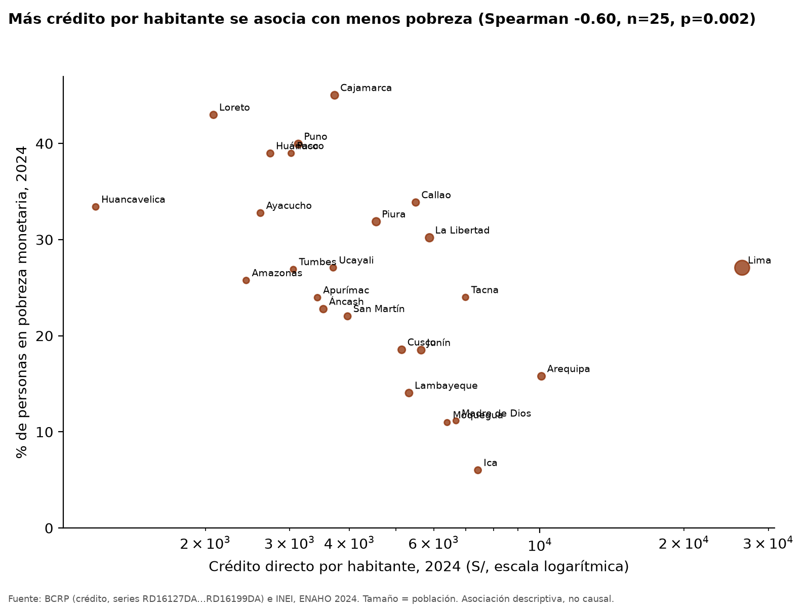

# Crédito, tasas de interés y pobreza departamental en el Perú, 2020–2024

## 1. Pregunta de investigación
**Tema.** Entre 2020 y 2024, ¿cómo evolucionaron el crédito del sistema financiero y la tasa de interés en el Perú, y en 2024 los departamentos con más crédito por habitante tenían menos pobreza monetaria? ¿Cambia esa relación entre áreas urbanas y rurales?

**Objetivo y delimitación.** Describir la evolución nacional del crédito y las tasas (BCRP, 2020–2024) y medir la asociación entre el crédito directo por habitante de cada departamento a fines de 2024 y su pobreza monetaria en la ENAHO 2024. El análisis es descriptivo: no estima efectos causales.

## 2. Fuentes y metodología
| Fuente | Datos | Series / módulos |
|---|---|---|
| BCRP (consultado con el servidor MCP del proyecto) | Crédito directo del sistema financiero al sector privado, total nacional y por departamento (millones de S/, fin de periodo, anual) | RD16202DA y RD16127DA…RD16199DA (una por departamento, cada tres códigos) |
| BCRP | Tasa de referencia de la política monetaria; tasa activa en moneda nacional (TAMN), mensuales | PD04722MM; PN07807NM |
| INEI | ENAHO 2024, módulos 34 (sumaria) y 02 (miembros) | 33,691 hogares en la sumaria; 108,664 residentes habituales |
| Curso | Límites departamentales (GeoJSON) | 25 unidades, unión por `ubigeo[:2]` = `FIRST_IDDP` |

**Procesamiento ENAHO** (Skill `limpiando-enaho`): residentes habituales (108,664 personas), unión personas–hogares con `validate="m:1"`, pobreza = `pobreza <= 2`. Nacional, área y departamento se estiman por hogares con `factor07 × mieperho` (método del INEI, que reproduce las referencias del curso con diferencia máxima de 0.05 pp); sexo usa personas con `facpob07`. Validación completa en `salidas/validacion.txt`.

**Crédito per cápita** = crédito departamental a fines de 2024 (S/) ÷ población estimada por ENAHO 2024 en ese departamento (suma de `factor07 × mieperho`). **Asociación**: correlación de Spearman (robusta a Lima, que es un valor extremo) y de Pearson, con prueba de permutación (20 000 permutaciones) porque n = 25. Las celdas departamento × área con menos de 30 hogares muestrales se excluyen (Callao rural no tiene hogares).

## 3. Resultados

### Hallazgo 1 – El crédito creció poco y las tasas subieron y bajaron
- El crédito directo total pasó de 369,826 millones de S/ en 2020 a 407,352 en 2024: **+10.1 % nominal** (serie RD16202DA). Su máximo fue 407,858 en 2022, de modo que desde entonces estuvo prácticamente estancado en términos nominales.
- La tasa de referencia (PD04722MM) pasó de 2.25 % en 2020-01 a un mínimo de 0.25 % (2020-04), un máximo de 7.75 % (2023-01) y 5.00 % en 2024-12.
- La TAMN (PN07807NM) se movió entre 10.49 % (2021-09) y 15.95 % (2023-09) y terminó en 14.88 %. Ambas tasas están correlacionadas (Pearson 0.76, n = 60 meses), y la tasa activa tuvo menor amplitud (5.5 puntos entre su mínimo y su máximo, frente a 7.5 de la tasa de referencia).

### Hallazgo 2 – El crédito está muy concentrado y se asocia con menos pobreza
- Crédito por habitante en 2024: **Lima S/ 26,461** frente a **Huancavelica S/ 1,180**, es decir 22.4 veces.
- Entre los 25 departamentos, la correlación de Spearman entre crédito per cápita y pobreza es **-0.60** (p de permutación = 0.0015); la de Pearson es -0.27, debilitada por Lima. Sin Lima ni Callao (n = 23) sube a -0.72 (Spearman) y -0.70 (Pearson).
- La pobreza va de 6.0 % (Ica) a 45.0 % (Cajamarca). Ica combina crédito alto (S/ 7,423) y pobreza baja; Lima es el contraejemplo: el mayor crédito por habitante y una pobreza de 27.1 %, cercana al promedio nacional (27.6 %).

### Hallazgo 3 – La brecha urbano–rural es grande y la asociación con el crédito se ve en ambas áreas
- A nivel nacional la pobreza es 39.3 % en áreas rurales y 24.8 % en urbanas, una brecha de 14.5 puntos porcentuales.
- Por departamento, el crédito per cápita se asocia con menos pobreza urbana (Spearman -0.56, n = 25) y con menos pobreza rural (-0.48, n = 24, p = 0.018); la asociación es algo más débil en el área rural. El crédito se mide por departamento, no por área: esta comparación es de la pobreza de cada área contra el crédito de todo el departamento.
- Los departamentos con menos crédito per cápita son más rurales (Spearman -0.68 entre crédito per cápita y % de población rural), de modo que la ruralidad es una variable que se mezcla con el crédito en esta asociación.

### Hallazgo 4 – La asociación resiste en rangos, pero no con un control lineal por ruralidad
- **Magnitud.** En un modelo lineal simple, duplicar el crédito per cápita se asocia con -6.0 puntos porcentuales de pobreza (coeficiente -8.70 por unidad logarítmica, p = 0.011; R² = 0.25).
- **Control por ruralidad.** Al agregar el porcentaje de población rural, el coeficiente del crédito baja a -6.32 y deja de ser estadísticamente distinguible de cero (p = 0.17; R² = 0.27). Con solo 25 observaciones y variables muy correlacionadas, el modelo tiene poca capacidad de separar ambos efectos.
- **Robustez en rangos.** La correlación de Spearman parcial, controlando por el rango de ruralidad, es -0.53 (p ≈ 0.008). Dejando fuera un departamento cada vez, el Spearman va de -0.57 (sin Loreto) a -0.67 (sin Lima): el resultado no depende de un solo departamento.
- **Otros resultados.** La asociación con la pobreza **extrema** es más fuerte (-0.68, n = 25). En cambio, el **crecimiento nominal** del crédito 2020–2024 de cada departamento no se asocia con su pobreza en 2024 (Spearman +0.21, p = 0.32): en este corte la asociación aparece con el nivel de crédito por habitante y no con su variación reciente.

## 4. Visualizaciones
- **BCRP – crédito y tasas, 2020–2024:** 
- **ENAHO – pobreza por área, 2024:** 
- **Mapa departamental de pobreza, 2024:** 
- **Cruce BCRP–ENAHO:** 
- **Dashboard interactivo** (mapa, dispersión y tabla con selectores): [`dashboard/index.html`](../dashboard/index.html), generado por la Skill `explorando-resultados`.

## 5. Interpretación
Los departamentos con más crédito por habitante tienden a tener menos pobreza monetaria, y esa tendencia aparece tanto en la pobreza urbana como en la rural. Sin embargo, el crédito está concentrado en pocos departamentos (Lima, Arequipa, Ica) y coincide con menor ruralidad, por lo que la asociación no puede atribuirse al crédito: en un modelo lineal con control por ruralidad el coeficiente del crédito deja de ser significativo (aunque la asociación en rangos persiste) y puede reflejar que los departamentos más urbanos y con más actividad económica tienen a la vez más crédito y menos pobreza. El caso de Lima muestra que mucho crédito no se acompaña necesariamente de baja pobreza. A nivel nacional, el crédito nominal creció poco mientras la política monetaria endureció y luego relajó su tasa de referencia.

## 6. Limitaciones
- **Asociación, no causalidad.** Son 25 observaciones transversales de un solo año; no hay control por ruralidad, actividad económica ni composición del crédito, y la inferencia de territorios a personas (falacia ecológica) no es válida.
- **Ubicación del crédito.** No se verificó en la metodología del BCRP cómo se asigna el crédito a cada departamento; si se registra por la ubicación de la agencia o la sede, parte del crédito de Lima podría financiar a hogares y empresas de otros departamentos.
- **Series nominales.** El crédito no se deflactó; el +10.1 % es nominal.
- **Desfase temporal.** El crédito es de fin de periodo 2024 y la ENAHO 2024 se levanta durante el año; la pobreza 2020–2023 no se analiza (solo se usó ENAHO 2024).
- **Denominador.** La población proviene de la ENAHO (muestral); no se contrastó con las proyecciones oficiales del INEI.
- **Incertidumbre.** Las estimaciones de pobreza son puntuales, sin errores estándar del diseño muestral; las celdas rurales pequeñas son menos precisas.
- **Uso del MCP.** El agente (`agente/investigar.py`) llama al servidor MCP con un cliente FastMCP por stdio, no con las herramientas MCP nativas de una sesión de Claude Code; el uso nativo de MCP y Skills se muestra por separado en `evidencias_ia/integracion/demo_nativa_claude_code.md` y en los logs de la evaluación.

## 7. Reproducibilidad
```bash
uv sync
uv run pytest mcp/ -q                 # 10 passed
uv run agente/investigar.py           # MCP + Skills -> salidas/, figuras/, mapas/
uv run agente/verificar.py            # verificación independiente (informes/verificacion_cifras.md)
uv run agente/generar_informe.py      # este informe
```
- Skills: `.claude/skills/limpiando-enaho`, `graficando-enaho`, `mapeando-enaho`. Servidor: `mcp/server.py`.
- Resultados: `salidas/resultados_investigacion.json`, `salidas/credito_pobreza_departamento.csv`, `salidas/indicadores.csv`, `salidas/validacion.txt`, `mapas/validacion_mapa.txt`.
- Bitácora de la ejecución (llamadas MCP y Skills): `salidas/bitacora_agente.json`.
- Verificación independiente por script (sin MCP ni Skills) de 7 cifras y comprobación manual de 3 cifras de ambas fuentes: `informes/verificacion_cifras.md`.
